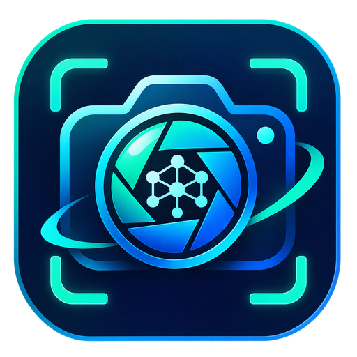

<p align="center"></p>

# AI Vision Studio

**See. Learn. Train. Innovate.**

AI Vision Studio is an open-source desktop application for computer vision, real-time object detection, image classification, custom model training, annotation, OCR, pose estimation, and hand landmark analysis.

Built with Electron, React, TypeScript, and TensorFlow.js. AI processing and project data are designed to remain local where supported.

## Development status

**Version:** 2.0.0-rc.1 (release candidate)

This project is not yet a certified stable release. Runtime inference, clean Windows installation, dependency auditing, and complete offline functionality require verification. See [release status](docs/RELEASE-STATUS.md).

## Windows 11

Install Node.js 22.13+ and VS Code, then run:

```powershell
npm install
npm test
npm run build
npm start
```

To build an unsigned Windows installer:

```powershell
npm run dist
```

## Features

- Webcam capture and image upload
- Image classification and object detection
- Video object tracking and approximate counting
- Dataset management and MobileNet-based transfer learning
- Model import/export and evaluation metrics
- Pose estimation, hand landmarks, person segmentation, OCR
- Bounding box annotation
- Local model caching for supported models

Some advanced modules require initial model downloads and may not function offline.

## Security and privacy

Do not commit private image datasets, model weights, secrets, or exported user data. Camera access is restricted to video capture. Review third-party licenses and select an appropriate project license before distribution.

## Release notes

See [docs/RELEASE-STATUS.md](docs/RELEASE-STATUS.md) for limitations and the production release checklist.
